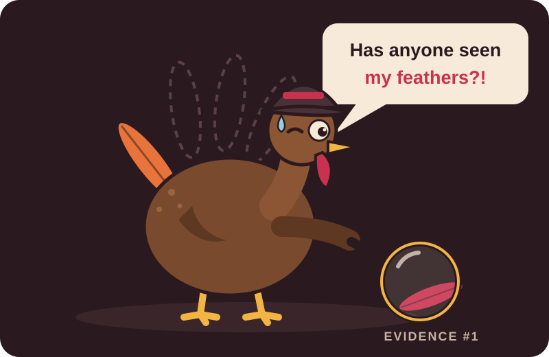

# The Great Gobble Hunt

A Thanksgiving scavenger hunt you play on your phone around the house. Teams solve riddles, find hidden sticky notes, and type in each note's code word to win back one of the turkey's 10 tail feathers. The first team back to the dining table wins.

**Play it:** https://jroltgen.github.io/gobble-hunt/

Scan the code with a phone camera to open the game. For a full-page sign to print and tape up, use [`gobble-hunt-qr-sign.pdf`](gobble-hunt-qr-sign.pdf) (or the [PNG](gobble-hunt-qr-sign.png)).

## How a game works

1. The host hides 10 sticky notes around the house, each with a code word written on it.
2. Each team opens the game on a phone and enters a team name.
3. The host says **Go** and every team taps **Start the hunt** at the same moment.
4. Each team gets the first 9 clues in its own shuffled order, so teams don't follow each other around the house. The last clue always leads to the dining table.
5. At each spot, the team finds the sticky note and types in its code word to unlock the next clue.
6. Stuck? **Get a hint** shows a hint but locks that team's code box for 15 seconds. Still stuck after the hint? **Show the code word** gives away the answer for another 30-second lockout.
7. Every phone shows a live race timer and that team's hint penalties.
8. The first team to reach the dining table with the finish screen showing wins.

## Host setup

Print [`feather-code-cards.pdf`](feather-code-cards.pdf) at actual size on one sheet of letter paper. It has all 10 code words, each inside a feather in the game's colors, ready to cut out. Laminate the sheet, cut around each feather (leave a thin clear edge so the seal holds), and tape them up.

Tap **Host setup** at the bottom of the start screen and enter the host code. The host sheet lists each hiding spot and the code word to write on its note. **Lock host sheet** hides it again on that phone.

Each phone keeps its own progress, so refreshing or closing the browser doesn't lose a team's place. **Start over** resets only that phone.

## Changing the hunt

Everything you'd want to change is in the `HUNT` block near the top of the `<script>` in [`index.html`](index.html):

| Setting | What it does |
| --- | --- |
| `stops` | The 10 stops. Each has a `place` (shown only on the host sheet), a `clue`, a `hint`, a `code`, and a trivia `fact`. The last stop is always the final one. |
| `prize` | Text shown on the finish screen. |
| `hostCode` | The code that opens the host sheet. |
| `hintLockSeconds` | How long a hint locks the code box. |
| `revealLockSeconds` | How much more lockout showing the code word adds. |

Commit the change to `main` and GitHub Pages republishes the site in about a minute. Anyone with the game already open needs to refresh the page.

If you change the web address, make a new QR code too, since the current one points to the link above.

## Good to know

- The site is a single HTML file with no server or database. Each phone tracks only its own team.
- This repository is public, so the code words and host code can be read in the page source. That's fine for a family game, but don't reuse a real password as the host code.
